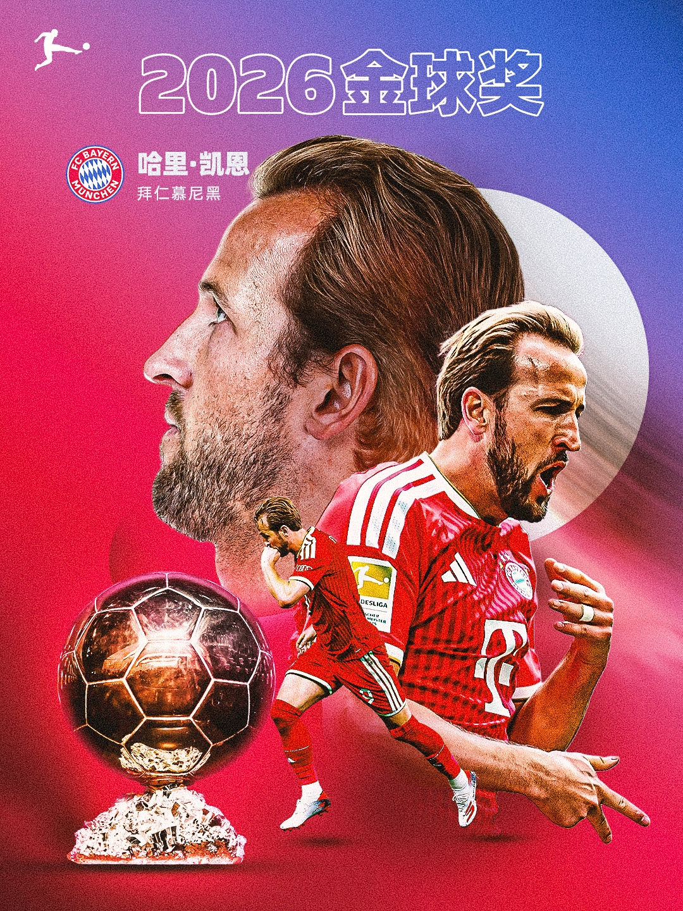
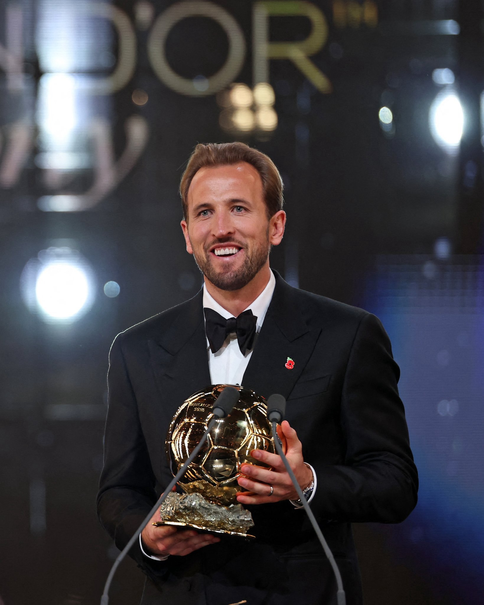
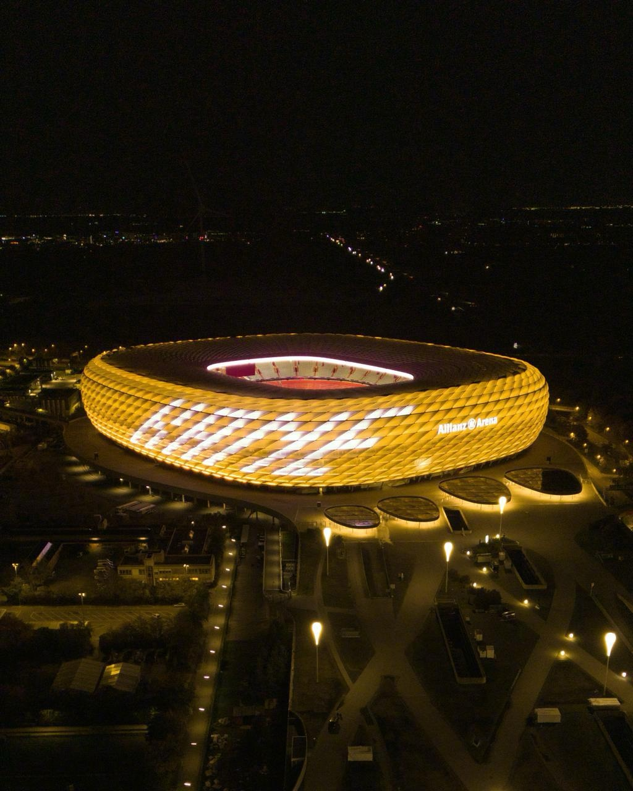
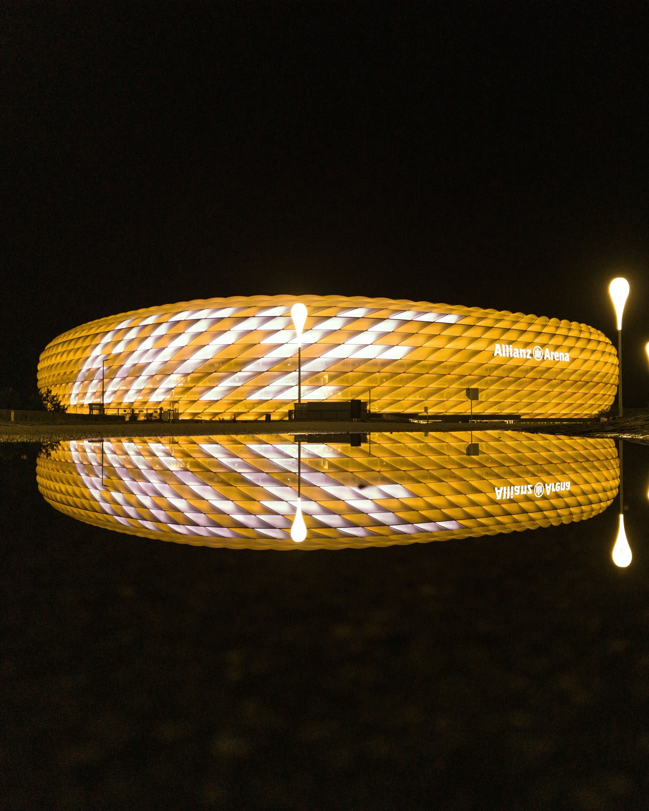

## 金球回家

2026年10月27日 晨，伦敦。

本年度的金球奖终于揭晓，拜仁慕尼黑9号、英格兰国家队队长，**Harry Kane**，举起了自己最重要的个人荣誉 - 金球奖（同时还有盖德.穆勒奖）。这个奖项，拜仁已经等待了 45 年（德甲等待了 30 年，英格兰等待了 25 年）。

## 感受

释怀。

难以想像，拜仁慕尼黑队史上第三个极盛时期，甚至可能是最辉煌的十几年里，5 冠王、全胜 6 冠王的加持竟然都没有获得过一次金球奖（是的，说的就是 2013 和 2020）。

上一位获得金球奖的拜仁队员，要追溯到 45 年前的鲁梅尼格。

今天，哈里.凯恩终于拿下了这该死的金球奖。谁说待在拜仁拿不到金球？！

## 数据

2025-2026赛季，凯恩个人数据如下：

- 德甲：31场 36球 5助
- 德国杯：6场 10球
- 欧冠：13场 14球 2助
- 德国超级杯：1场 1球
- 世预赛：5场 5球
- 世界杯：7场 6球 1助
- 国家队友谊赛：2场 1球

全年 **73球 8助**，21世纪以来个人数据仅次于 2012 年梅西的 69场 91球 22助 的神迹。

球队成绩：

- **德甲冠军**
- **德国杯冠军**
- **德国超级杯冠军**
- **欧冠4强**
- **世界杯季军**

荣耀，实至名归。

## 安联夜色

今夜，安联体育场为你点亮。

## 感言

> Work hard in silence. Let success be your noise.

这是 哈里.凯恩 最好的写照。

拜仁的下一个金球，希望是你 - 迈克尔.奥利塞！
