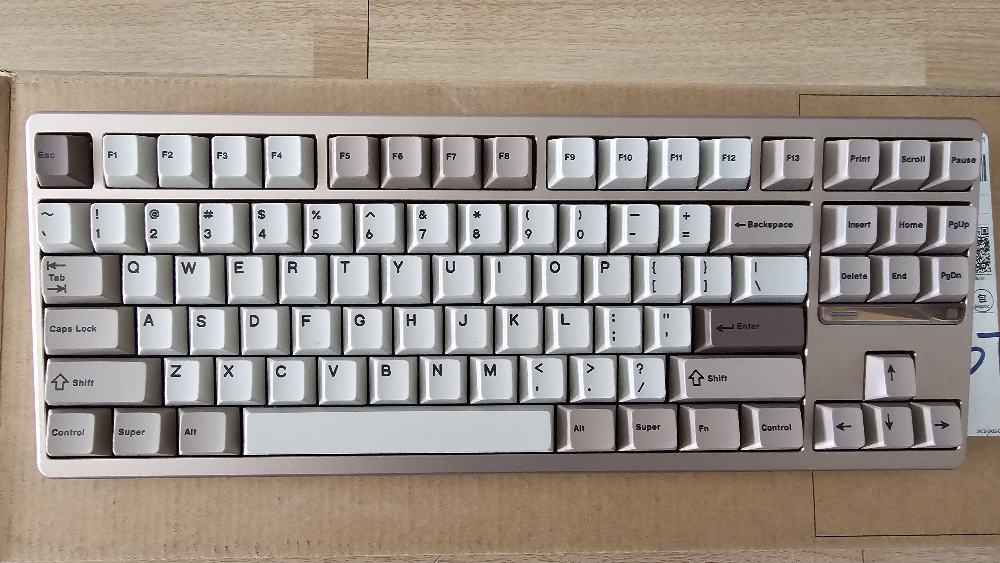
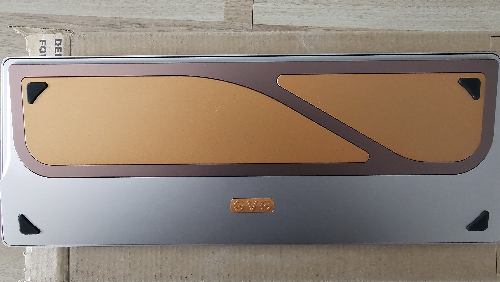

## 背景

这把键盘是原客制化厂商 QK 面向量产成立了新的工作室 evo 推出的第一款产品。卖点是金属外壳、独特的铍铜结构、快拆。厂商名为 TickTypes，中文叫“塔塔次方”。

入手时已经不是第一批次了。首批爆出设计问题导致铍铜结构失效，后来的批次做了一些调整优化（应该就是截短了底层海绵）。入手原因是觉得这个铍铜结构挺有意思。

## 开箱

砂金配色，还挺好看。80 配列是最正统配列了，除了小键盘都是完整的，少了个性，但不会出错。

## 使用

- 入手的是沉金定位板，脆轴。使用了一段，又买了一张 PC 定位板和配套闷轴，改成了闷轴款。

- 三模键盘，**蓝牙连接非常稳定**，普通使用几乎没有吞键情况，续航也非常好。

- 键帽很厚实，1.7mm。**恩溶**代工，做工也很好。

- 多了 **F13** 键。比标准 87 键多了一键，导致 F 区按键位置与标准键盘不同。但 F 区按键我也不是盲打，所以几乎没有影响。不过我实在想不出用这个 F13 做什么，87 本来就是标准配列了，该有的功能键已经全部都保留了。这个键一直空置。
