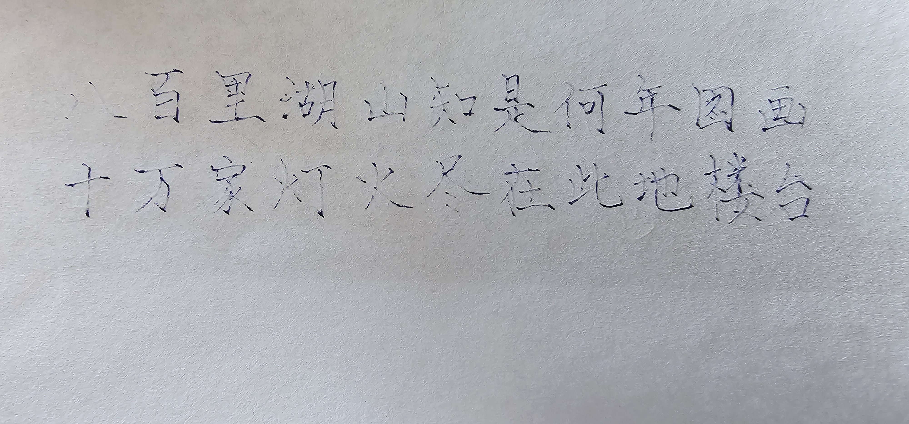
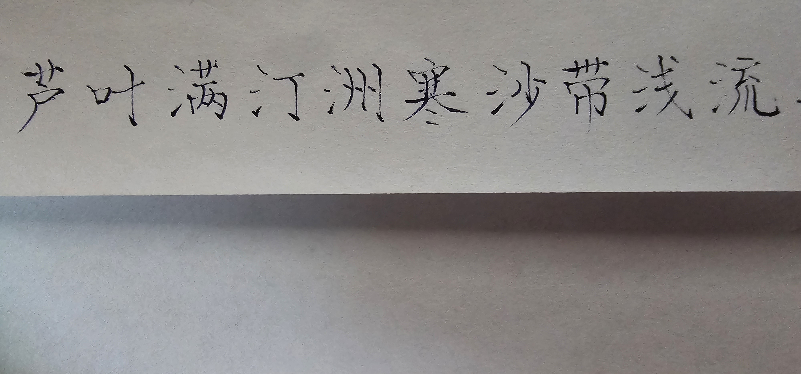
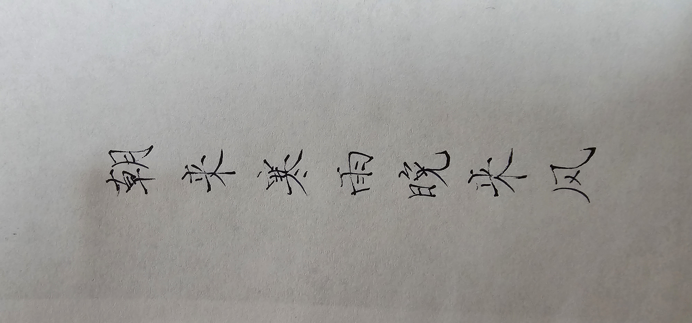
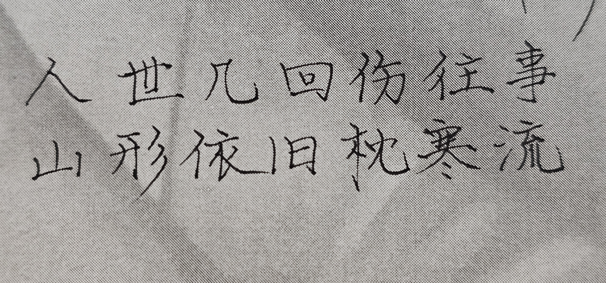

## 钢笔

2025年底一时心血来潮买了一支施耐德钢笔。当时应该是看了胡成老师的微博，我太喜欢胡成老师的字了。

其实一直想买一支美工笔，无他，没用过，貌似因为笔尖是弯的，能变换粗细写出不同的风格，略有毛笔的意境。然而手机上看了好些，都觉得太丑。这支施耐德很简约，也很便宜，不到30元。感觉买不了吃亏，也买不了上当。多种颜色，入了个酒红色的。

好些年前附庸风雅买过一支LAMY，一共也没写过几个字。主要也是因为写的太差，自然也没有多写的兴致。

钢笔的墨囊因为这么久没用，已经快干涸了。恰好手头有打印的A4纸，废物利用在背面写写画画，防止钢笔滞水干涸。

- 八百里湖山

墨囊只能勉强出一点水，写起来还挺有意思。看起来是蓝黑的颜色。

> 这两句和徐渭的原文似乎也有出入，已经记不清了。

- 欲买桂花同载酒

写画了一阵，出水好一些了。

> "欲买桂花同载酒，终不似、少年游"。终于也到了这样的年纪呢。

换了新墨囊。这个是黑色的，说不上哪个颜色更好。

> 后主的两首《相见欢》都是名篇。第一次读到的时候，是"胭脂泪，留人醉"的版本；后来看到"相留醉"还有点不习惯。不过似乎以后者居多。

- 人世几回

已经彻底恢复正常了。不过钢笔出水太过顺畅，反而不习惯。没有那种毛笔的气质了。

> 想起白居易和刘禹锡的典故。两人第一次见，刘放出了一句王炸："**沉舟侧畔千帆过，病树前头万木春**"。这一次白又组织了一场金陵怀古，本想找回场子，结果刘又放出另一句王炸。很有意思。
